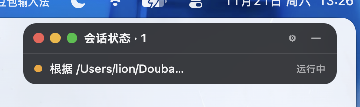

# DSH Session Status Overlay · dsh-notify-traffic

[中文](README.md) · **English**

Running 3–10 sessions at once? You shouldn't have to click through each one to find out which is waiting on you.

This is an **always-on-top system window**: it stays in front when DSH is minimized, when you switch apps, and across desktop spaces. Four-color lights summarize every session, approvals and questions are **answered inside the window**, and completions and blockers each get one short spoken alert. Quiet by default — it only shows up when something needs you.



## Features

- **Four-color lights**: 🔴 needs you (approval/question) · 🔴 error · 🟡 running · 🟢 just finished · ⚪ idle
  - Both reds use icon and text to distinguish "waiting on you" from "failed" — never color alone
  - Errors flash for 1.2s then go static; with reduced motion they're static immediately and show `!`
- **Always on top**: `NSWindow.level = .floating` with `canJoinAllSpaces`, so it stays above every app after DSH is minimized
- **Handle blockers in place**: approval cards offer "Allow once / Reject"; question cards submit your choices — no trip back to the conversation
- **Click a session to jump**: clicking a row brings DSH forward and switches to that session
- **Sound alerts** for completion, approval, question and error
  - Completions within 3s merge into one line ("3 tasks done")
  - Blockers and errors preempt (400ms window) instead of waiting for the merge
  - Quiet hours suppress completion sounds only — blockers still play
  - Completion sounds stay silent while DSH is focused
- **Three forms**: card · pill · single light, switchable from either entry point
- **Settings in two places**: the gear in the titlebar and **Settings → Session overlay** read and write the same config
- **Stays manageable**: 8 rows max with a "+N more" counter; idle gray sessions age out

## Requirements

- macOS (the system window is AppKit)
- DeepSeek Harness desktop (verified on the 0.2.2-rc series)
- `swiftc` from Xcode Command Line Tools — only needed to compile the window on first enable

> Without the Swift toolchain, or if the system window exits, the plugin falls back to an in-frame overlay inside DSH. No functionality is lost.

## Install

### From npm

```sh
cd ~/.dsh/profiles/desktop
pnpm add dsh-notify-traffic
```

Add `"dsh-notify-traffic"` to `dsh.profile.bundles` in `package.json`, then restart DSH.

### Local link (for development)

```sh
git clone https://github.com/Effortful-lion/dsh-notify-traffic ./
cd ~/.dsh/profiles/desktop
pnpm add "link:/absolute/path/dsh-notify-traffic"
```

Add it to `dsh.profile.bundles` as well.

### Plugin panel

DSH sidebar → Plugins → Add plugin, enter `dsh-notify-traffic` (or `link:/absolute/path`).

## Install gotchas

### You may not get the latest version

`pnpm add dsh-notify-traffic` sometimes resolves to an older release:

1. The profile already pins a range like `^1.0.0`, so pnpm reuses the lockfile entry
2. DSH's supply-chain cooldown (`minimumReleaseAge`) withholds freshly published versions

Ask for the exact version:

```sh
pnpm add dsh-notify-traffic@1.0.1
```

To stay off stale releases, pin the profile range exactly:

```json
"dsh-notify-traffic": "1.0.1"
```

### The plugin panel refuses to remove it (`bundle-in-use`)

Saving anything on the settings page leaves a config block in the profile's `cordis.patch.yml`:

```yaml
- id: notify-traffic
  name: dsh-notify-traffic
  config: { ... }
```

While that block exists the plugin manager treats the bundle as in use. Either delete the block first, or bypass the manager with `pnpm remove dsh-notify-traffic`.

## When a restart is needed

| What you changed | How it takes effect |
| --- | --- |
| Any toggle on the settings page | **Immediately** — written back to the profile and applied in memory |
| `config` in `cordis.patch.yml` | **Immediately** — HMR recomposes with the new config |
| `bin/overlay.html` (window appearance) | The window reloads itself, **no DSH restart** |
| `client.js` (in-DSH panel and settings page) | Refresh the DSH page; client-hmr pushes the new bundle |
| `index.js` / `lib/*.js` (host logic) | **Restart DSH** |

The last row is a DSH constraint, not laziness here: Cordis HMR only hot-swaps packages that are **symlinked** inside the profile. An npm install is a real directory, so host module changes are marked as pending until a restart. Installed via `link:`, the plugin is inside the hot-swap set and host changes do hot-reload.

### How the window avoids restarts

The host puts `uiRev` (the `overlay.html` mtime) into `/state`. The window compares it on every poll and calls `location.reload()` when it moves, so style and copy changes land within a second or two of saving.

## Usage

| Action | Where |
| --- | --- |
| Close the window | red dot |
| Collapse to pill | yellow dot, or `—` in the titlebar |
| Expand to card | green dot, or `⤢` on the pill |
| Shrink to single light | `◦` on the pill; click the light to go back |
| Open settings | gear in the titlebar |
| Move the window | drag the empty part of the titlebar (all three forms) |
| Approve / reject | card buttons |
| Answer a question | pick options → Submit |
| Open a session | click a row |

## Settings

Window gear, or **Settings → Session overlay**:

| Group | Items |
| --- | --- |
| Placement | system window / in-frame / both / off |
| Initial form | card / pill / single light |
| Sound | master switch, approval, question, error, completion, completion-only-when-unfocused, quiet hours, volume, merge window |
| Rhythm | green hold, idle eviction, list cap, approval timeout, error flash cap |

Changes apply immediately and are written back to the profile's plugin config.

## Architecture

```
DSH host (Node child process)              System window (separate native process)
├─ agent/status · agent/error              ├─ AppKit borderless transparent window
│  └─ four-color derivation                │   level=.floating
├─ approval/request · user-questions       │   canJoinAllSpaces
│  └─ prepend the waterfall, await window  ├─ WKWebView on a same-origin page
├─ sound decisions (merge/dedupe/quiet)    │   /notify-traffic/overlay
├─ /notify-traffic/* data plane            └─ polls /state, POSTs /answer
└─ spawn / kill bin/ntf-overlay (flock single instance)

Browser (DSH web UI)
├─ settings.section "Session overlay" ← reads/writes /config
└─ shell.overlay frame layer (when placement is in-frame / both)
```

**Why a native process**: DSH's host plugin runs in an `ELECTRON_RUN_AS_NODE` Node child, not the Electron main process, so it has no `BrowserWindow`. To keep a window above every app after DSH is minimized, the plugin spawns its own AppKit window process and talks to it over loopback HTTP.

**Why approvals are answered on the host**: the built-in approval pending object exposes no RPC — an approval can only be settled by whoever holds the waterfall. The host claims it with `prepend` and the window decides over HTTP, so each `requestId` resolves exactly once.

## Known limitations

- The system-level window is macOS only; other platforms fall back to the in-frame overlay
- Sound uses WebKit speech synthesis, so the voice depends on what's installed
- After the approval timeout (120s default) the request returns to the conversation; it never decides for you
- Closing via the red dot requires re-enabling the plugin or restarting DSH to bring it back

## Development

```sh
pnpm run check           # syntax check both entry points
pnpm run build:overlay   # rebuild the native window (swiftc)
```

The system window UI lives in `bin/overlay.html`, its native shell in `bin/overlay.swift`; the in-frame overlay and settings page are in `client.js`; state machine, sound engine and decisions live in `lib/`.

## License

[MIT](LICENSE)
