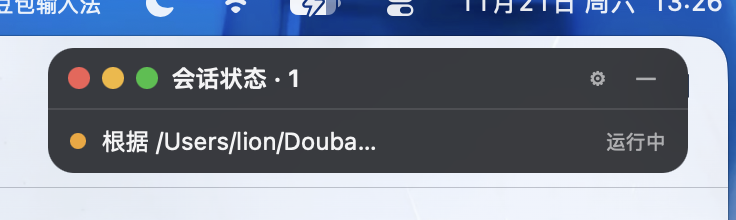

# DSH 会话状态悬浮窗 · dsh-notify-traffic

**中文** · [English](README.en.md)

同时跑 3–10 个会话时，你不需要逐个窗口点开才知道哪个在等你。

它是一块**系统级置顶的悬浮窗**：DSH 最小化、切到别的应用、换桌面空间，它都还在最前面。四色状态灯汇总所有会话，审批与提问**直接在窗内处理**，完成与阻塞各有一次轻量语音提醒。默认安静——只在有事时出现。



## 功能

- **四色状态灯**：🔴 待处理（审批/提问）· 🔴 出错 · 🟡 运行中 · 🟢 刚完成 · ⚪ 空闲
  - 同一个红色用图标与文案区分「等你」和「出错」，不靠颜色猜
  - 出错闪动 1.2 秒后转静态红；开启「减少动态效果」时直接静态并显示 `!`
- **系统级置顶**：`NSWindow.level = .floating`，随桌面空间切换（`canJoinAllSpaces`），DSH 最小化后仍浮在所有应用之上
- **窗内直办阻塞**：审批卡片给「允许一次 / 拒绝」，提问卡片直接点选项提交，不用回到会话
- **点会话直接跳转**：点列表里的会话行，DSH 被拉到前台并切到那个会话
- **声音提醒**：完成、审批、提问、出错各一次播报
  - 3 秒内多个完成合并成一句（「3 个任务完成」）
  - 阻塞与出错抢占播放（400ms 短窗口），不等合并
  - 静默时段只压完成音，阻塞照常会响
  - DSH 在前台时默认不播完成音
- **三种形态**：卡片 · 胶囊条 · 单灯，两套入口都能切
- **两处设置**：标题栏齿轮（窗内设置）与 **设置 → 会话悬浮窗**，读写同一份配置
- **会话过多不失控**：最多显示 8 行，其余折叠成计数；空闲超时的灰色会话自动移出

## 环境要求

- macOS（系统级窗口走 AppKit）
- DeepSeek Harness 桌面版（0.2.2-rc 系列验证）
- `swiftc`（Xcode Command Line Tools 自带）——只在**首次启用时**编译系统窗口用

> 没有 Swift 工具链、或系统窗口退出时，插件会自动退回 DSH 界面内的浮层，功能不丢。

## 安装

### 方式一：从 npm 装

```sh
cd ~/.dsh/profiles/desktop
pnpm add dsh-notify-traffic
```

再把 `"dsh-notify-traffic"` 加进 `package.json` 的 `dsh.profile.bundles`，重启 DSH。

### 方式二：本地链接（开发用）

```sh
git clone https://github.com/Effortful-lion/dsh-notify-traffic ./
cd ~/.dsh/profiles/desktop
pnpm add "link:/绝对路径/dsh-notify-traffic"
```

同样把它加进 `dsh.profile.bundles`。装好后右上角出现悬浮窗，**设置**左栏出现「会话悬浮窗」。

### 方式三：插件面板

DSH 侧边栏 →「插件」→ 添加插件，填 `dsh-notify-traffic`（或 `link:/绝对路径`）。

## 使用

| 操作 | 位置 |
| --- | --- |
| 关闭窗口 | 红点 |
| 收起为胶囊 | 黄点，或标题栏 `—` |
| 展开为卡片 | 绿点，或胶囊 `⤢` |
| 收成单灯 | 胶囊 `◦`；点单灯回到胶囊 |
| 打开设置 | 标题栏齿轮 |
| 移动窗口 | 按住标题栏中间空白处拖动（三种形态都能拖） |
| 处理审批 | 卡片「允许一次 / 拒绝」 |
| 回答提问 | 点选项 →「提交」 |
| 打开会话 | 点列表里的会话行 |

## 设置

窗口齿轮，或 **设置 → 会话悬浮窗**：

| 分组 | 项 |
| --- | --- |
| 悬浮窗位置 | 系统窗口 / 页面内 / 两者都开 / 关闭 |
| 初始形态 | 卡片 / 胶囊 / 单灯 |
| 声音 | 总开关、审批、提问、出错、完成、仅失焦播完成音、静默时段、音量、合并窗口 |
| 节奏 | 绿灯保持、空闲移出、列表上限、审批等待、出错闪动上限 |

改动立即生效，同时写回 profile 的插件配置。

## 架构

```
DSH 宿主（Node 子进程）                     系统窗口（独立原生进程）
├─ agent/status · agent/error              ├─ AppKit 无边框透明窗口
│  └─ 四色状态派生                          │   level=.floating
├─ approval/request · user-questions       │   canJoinAllSpaces
│  └─ prepend 抢占瀑布，等窗口决定          ├─ WKWebView 加载同源页面
├─ 声音决策（合并/去重/优先级/静默）        │   /notify-traffic/overlay
├─ /notify-traffic/* 数据面                 └─ 轮询 /state、POST /answer
└─ spawn / kill bin/ntf-overlay（flock 单实例）

浏览器（DSH Web 界面）
├─ settings.section「会话悬浮窗」← 读写 /config
└─ shell.overlay 帧浮层（「页面内 / 两者都开」时渲染）
```

**为什么需要一个原生进程**：DSH 的宿主插件跑在 `ELECTRON_RUN_AS_NODE` 的 Node 子进程里，不是 Electron 主进程，拿不到 `BrowserWindow`。要做到「DSH 最小化后仍浮在所有应用之上」，只能由插件 spawn 一个自己的 AppKit 窗口进程，数据走回环 HTTP。

**为什么审批在宿主侧答**：内置审批的待处理对象没有任何 RPC，审批只能由持有瀑布链的一端结算。宿主 `prepend` 抢占后由窗口经 HTTP 下决定，同一 `requestId` 只生效一次。

## 已知限制

- 系统级窗口只有 macOS 版；其它平台自动退回页面内浮层
- 声音走 WebKit 的语音合成，音色取决于系统安装的语音
- 审批超时（默认 120 秒）后交回会话内处理，不会替你做决定
- 红点关闭窗口后，需重新启用插件或重启 DSH 才会回来

## 开发

```sh
pnpm run check           # 两个入口的语法自检
pnpm run build:overlay   # 重新编译系统窗口（swiftc）
```

系统窗口的界面在 `bin/overlay.html`，原生壳在 `bin/overlay.swift`；DSH 界面内的浮层与设置页在 `client.js`；状态机、声音、声音决策在 `lib/`。

## License

[MIT](LICENSE)
